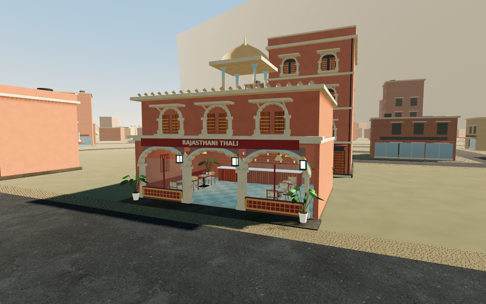
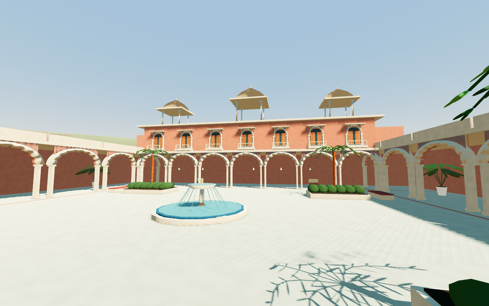

# Restaurants and palace — actual 3D review, 9 November 2026

These are Godot renders of the **live city geometry**, not concept illustrations. The user asked for the café's level of detail to extend to restaurants, palaces and the surrounding city. GitHub was fast-forwarded to `1e5a18e` before implementation. Visual quality still awaits the user's review.

## See it in the game

- **MAP → DINING → Rajasthani Thali**: terracotta haveli, carved arches, shuttered upper windows and a rooftop chhatri.
- **MAP → DINING → Kalidoscope**: blue/cream garden-pavilion design, checker floor, pergola, brass accents and cane seating.
- **MAP → DINING → Spicy King**: green/wood brasserie, canvas canopy, clerestory and ribbed timber fascia.
- **MAP → DISTRICTS → Nahargarh Fort**: walk east from the arrival marker into the large open gateway. Explore the fountain courtyard, planted courts and arcaded galleries; use **G / SIT** near the benches.

The three dining destinations are existing named OSM amenities. Their new architecture is an original artistic interpretation, **not a claim about those businesses' actual appearance**. Five restaurant-tagged café amenities continue using the existing café design; the other **38 restaurants** now use one of the three new templates. Café identities and positions are retained.

## Before / after

Cameras for each paired exterior are identical, including FOV. The world-only review camera omits HUD and characters to expose the architecture. Separate gameplay shots include the actual hero/HUD.

| Location | Before | After | Inside |
| --- | --- | --- | --- |
| Rajasthani Thali | [Before](before-rajasthani-thali-exterior.png) | [After](after-rajasthani-thali-exterior.png) | [Dining room](after-rajasthani-thali-interior.png) |
| Kalidoscope | [Before](before-kalidoscope-exterior.png) | [After](after-kalidoscope-exterior.png) | [Dining room](after-kalidoscope-interior.png) |
| Spicy King | [Before](before-spicy-king-exterior.png) | [After](after-spicy-king-exterior.png) | [Dining room](after-spicy-king-interior.png) |
| Nahargarh | [Before](before-nahargarh-fort-exterior.png) | [After](after-nahargarh-fort-exterior.png) | [Courtyard](after-nahargarh-fort-interior.png) |




[Restaurant gameplay](after-restaurant-gameplay.png) · [DINING atlas](after-dining-atlas.png) · [Palace gameplay](after-palace-gameplay.png) · [Gateway detail](after-palace-gateway.png)

## What changed in 3D

- `heritage_kit.gd`: shared extruded nine-cusp arch meshes, turned columns and domes, window/shutter/chajja assemblies, jali screens, lanterns, chhatris and feathered date palms. These are actual geometry with depth and silhouettes, not facade pictures. They join the existing cell/material/mesh MultiMesh batches.
- `restaurant_architecture.gd`: hollow rooms with separate walls/floor/roof, open central doors and ramps, glazed side bays, 1.5 m central aisles, fitted service counters, shelves/tableware, lamps, plants and registered seats/patrons. Layout adapts to small plots. Existing café furniture/materials are reused.
- `palace_architecture.gd`: a 48 m courtyard, west-facing gate toward the existing road, seven-bay main loggia, two arcaded side galleries, balcony screens, six rooftop pavilions, fountain, planted courts and benches. It replaces the old fort boxes; it is a Jaipur-inspired environment, not a measured Nahargarh/Madhavendra Bhawan reconstruction.
- `neighborhood_architecture.gd`: nearby background shells have framed windows, projected balconies, shop shutters, awnings, cornices, open rooftop parapets and drainpipes. Applied around restaurants (30 m) and the initial Chandpole neighbourhood (95 m). These background shells are not enterable.
- Restrained procedural mineral texture, quieter earth/grass colours and lower sun/fill intensity replace noisy yellow ground and flat heritage materials. No new downloaded texture packs or photographic facades.
- DINING destinations are appended after existing districts/services, preserving their indices. Restaurant icons now appear on the atlas/radar.

## References and how they were used

Viewed/researched 9 November 2026. External photographs are reference-only and are **not bundled or used as textures**.

1. Existing project [Crazy Cafe review](../09-crazy-cafe/README.md): human-scale furniture, framed openings, visibly furnished interiors, layered fascia, planters and warm practical lights. Existing `cafe_reference.gd` furniture is reused directly.
2. [Villa Palladio photo essay, Architectural Digest India](https://www.architecturaldigest.in/story/inside-villa-palladio-in-jaipur/): the courtyard photograph was inspected for scalloped openings, cornice depth, a coherent accent palette, checker paving, planting and a central fountain. No literal replica or copied photo panels.
3. [City Palace, Rajasthan Tourism](https://www.tourism.rajasthan.gov.in/content/rajasthan-tourism/en/tourist-destinations/city-palace.html): Rajput/Mughal palace vocabulary and the Mubarak Mahal reference.
4. [City Palace Complex, Cornell University visual collection](https://digital.library.cornell.edu/catalog/ss%3A3856929): documented cusped arches and palace facade rhythm.
5. [Bar Palladio, Architectural Digest India](https://www.architecturaldigest.in/magazine-story/bar-palladio-jaipur-marie-anne-oudejans/): blue/cream palette direction for a distinct restaurant family.

## How to keep improving the game's 3D

1. **Work at the player's eye level.** Choose one block, use real reference elevations and consistent metre-scale doors/windows/furniture, then review actual front/three-quarter/interior/gameplay renders. A polished 2D concept cannot validate the playable geometry.
2. **Shape first, materials second.** Recess doors/windows, give cornices thickness, break the roof silhouette, and model an interior when an entrance is visible. Use one reusable architecture kit rather than repeating the same box citywide.
3. **A few coherent materials per place.** A warm plaster, stone trim, wood and one accent colour are enough. Correct world-scale mapping and restrained roughness are more useful than high-contrast photographic noise everywhere.
4. **Populate places deliberately.** Seating, menus, serving objects, plants, light fixtures and residents should explain how the room is used. Keep the main path and camera clear.
5. **Next art pass:** improve close-up bevels and wall/ground contact shading; add better distant-tree LODs, diverse shop signage and kitchen props; review day/evening lighting and collision at every small plot. The huge map still has generic distant buildings.
6. **Profile the tablet before spreading more detail.** Retained: shared meshes/materials, instancing, 170 m detail cutoff, 600 m main meshes, cell collision culling, non-shadowed local lights with distance fade. This pass increases visible draw calls; desktop software-rendered captures do not establish Android FPS. Device performance and APK installation were not part of this pass.

## Reproduce

```sh
./play.sh --headless --editor --import --quit
./play.sh --headless --script res://tests/architecture_review.gd
./play.sh --headless --script res://tests/city_smoke.gd
./play.sh --headless --script res://tests/cafe_review.gd
./play.sh --headless --script res://tests/city_refresh.gd
xvfb-run -a -s '-screen 0 1280x800x24' ./play.sh --script res://tests/architecture_capture.gd
xvfb-run -a -s '-screen 0 1280x800x24' ./play.sh --script res://tests/architecture_gameplay_capture.gd
```

`architecture_capture.gd -- --before` is only for a baseline checkout; do not use it on the updated geometry, or it will overwrite the retained before images. `-- --palace-only` captures just the fort.

**Verified:** all four suites above passed with 0 failures. Engine import and capture scripts completed without script errors. Detailed capture draw-call counts and platform limitations are in [validation.json](validation.json).

The architecture suite checks all 38 restaurant doors/central aisles/floors/seats, all three styles, palace entry/floor/fountain collision, dining destinations and real player traversal from atlas arrivals. The old city smoke jump check was waiting only eight frames despite the existing 0.16 s mocap anticipation; it now waits 24 frames before checking takeoff. No jump mechanics were changed.
