# VKI + VDN: compact world and graphics pass

10 November 2026. These are **actual Godot renders**, using the runtime map and meshes in the desktop Compatibility renderer. The supplied Jaipur concept image guided warm façades, greenery and the four vehicle families. The implementation is stylized mobile 3D; it does not reproduce the poster's photoreal detail.

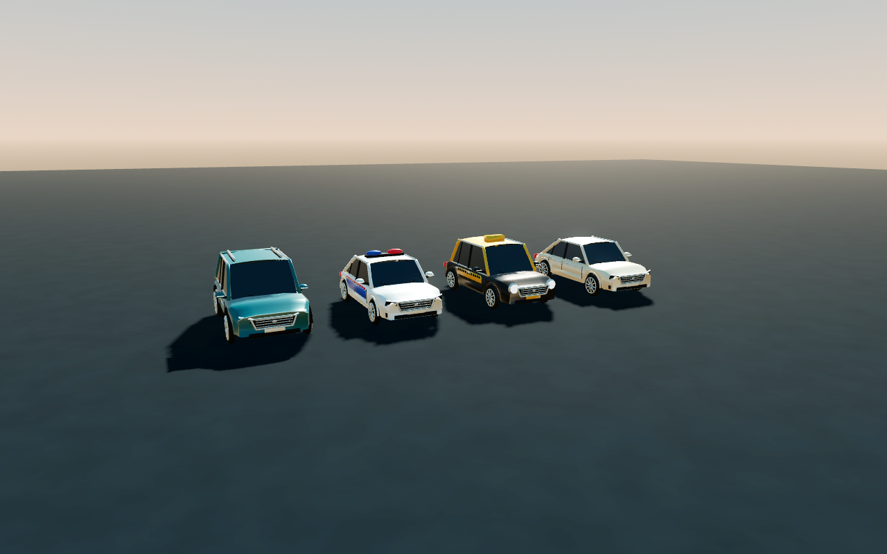

| Active map | Previous | Current |
|---|---:|---:|
| Playable footprint | 5.016 × 5.764 km | 1.716 × 2.420 km |
| Area | 28.91 km² | 4.15 km² (85.6% smaller) |
| Loaded road pieces | 6,323 | 1,662 |
| Building records | 9,348 | 2,683 |
| District scope | Jaipur-wide | VKI South + Vidhyadhar Nagar |

The crop retains OSM road geometry, 7 parks and local mapped/authored amenities. It clips line segments at the boundary without connecting disconnected pieces. The archived `jaipur_city.json` stays unchanged. `vki_vdn_city.json` adds 1,148 clearly tagged artistic roadside plots, including 791 VKI workshops; rotated-footprint tests keep new parcels off roads, existing buildings, amenities and parks. Buildings, dimensions and heights are artistic rather than surveyed.

The active destinations are Vidhyadhar Nagar, Central Spine, VKI South, Crazy Cafe and Smriti Park. The service tab provides the six fictional neighborhood businesses; the dining tab provides three fictional local venues: Gulabi Thali, Spine Garden Kitchen and VKI Canteen. All have walkable entrances. Delivery missions stay within the crop. A safe road arrival replaces the old spawn that intersected the authored cafe; landmark travel parks the car on a clear road. Cash and outfit survive old-save migration; obsolete city-wide discovery/mission indices reset.

## Actual world views

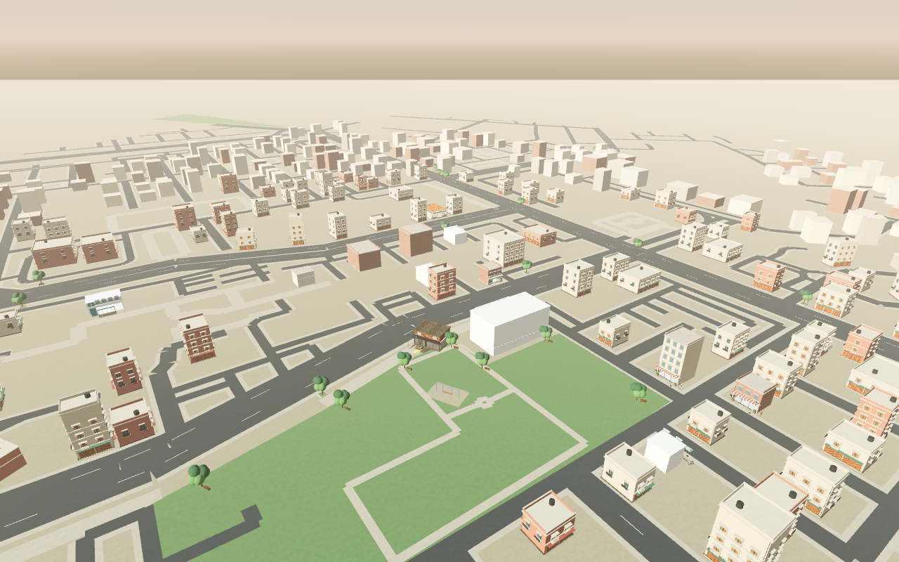
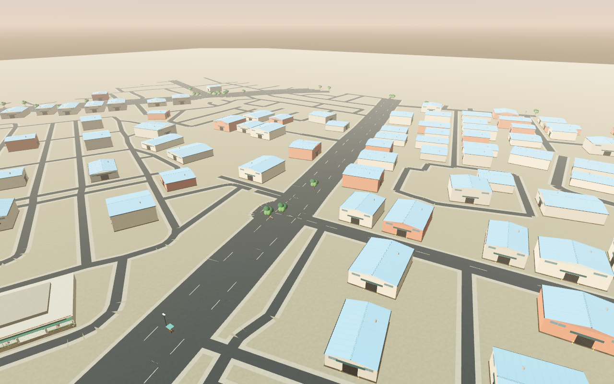
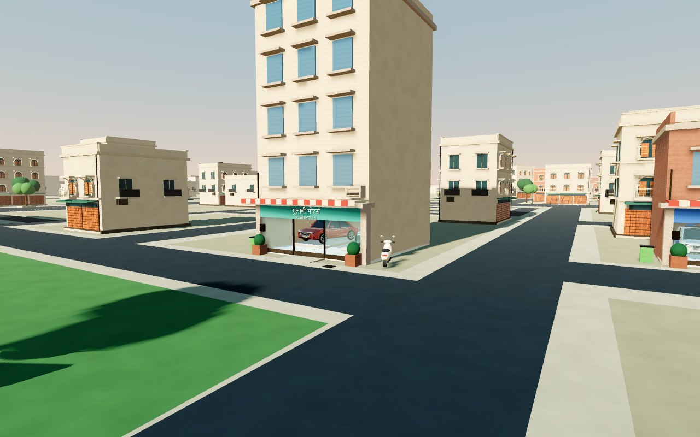
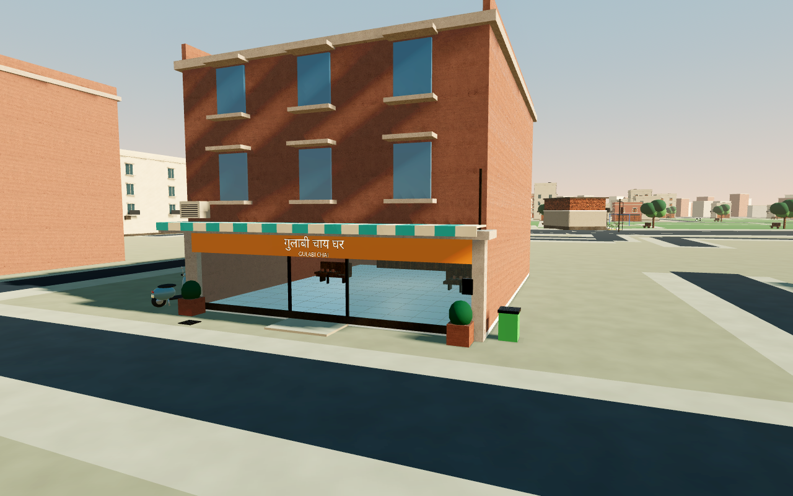
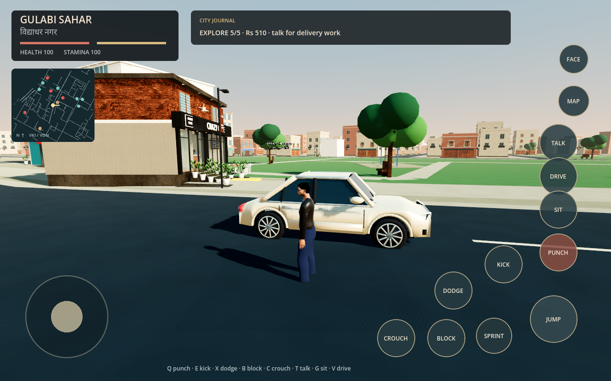
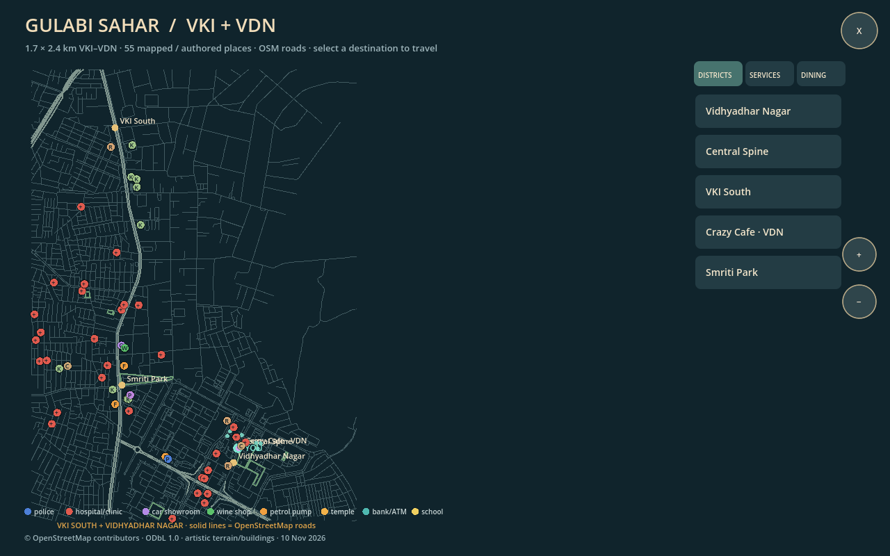

VKI has pitched sheet-metal roofs, ridge caps, gutters, shutters, high windows, bollards and workshop signs. VDN façades have recessed windows, awnings, balconies, side-elevation windows and vents, roof parapets and shop signs. Planted verges, larger multi-lobed trees, benches, street banners and the Smriti Park pavilion add street-level detail. Map-limit signs mark clipped exits. Footways use paving instead of asphalt.

Warm directional lighting and quieter materials replace noisy surface contrast. Terrain/paving receive building shadows without casting acne-producing shadows onto adjacent flat surfaces. Existing cell streaming and material-based MultiMesh batching remain. Distant buildings simplify with distance; this is not a fully detailed or photoreal city.

## Runtime vehicles

| Sedan | Taxi |
|---|---|
| 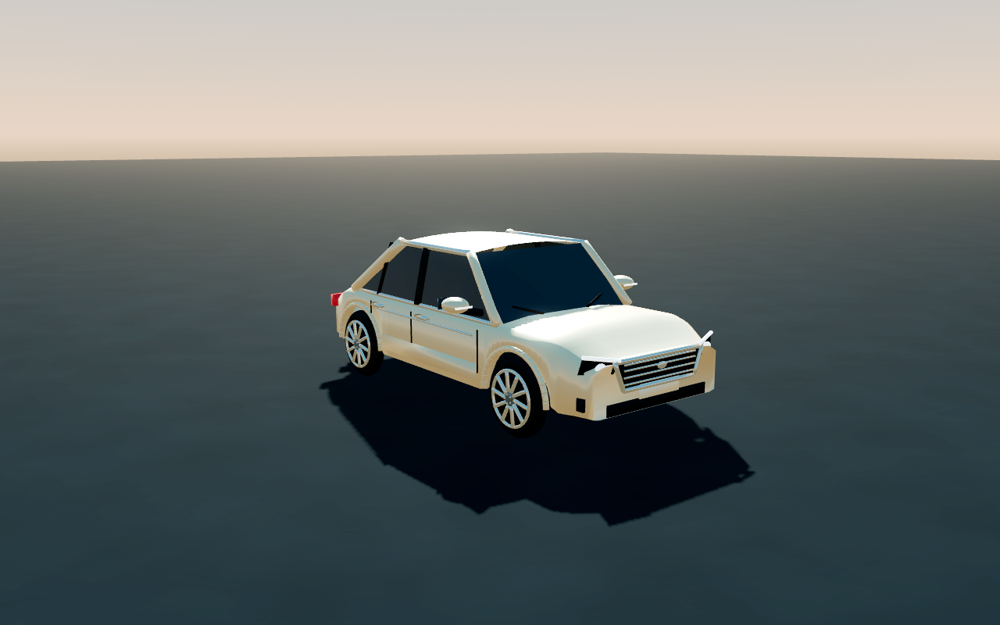 | 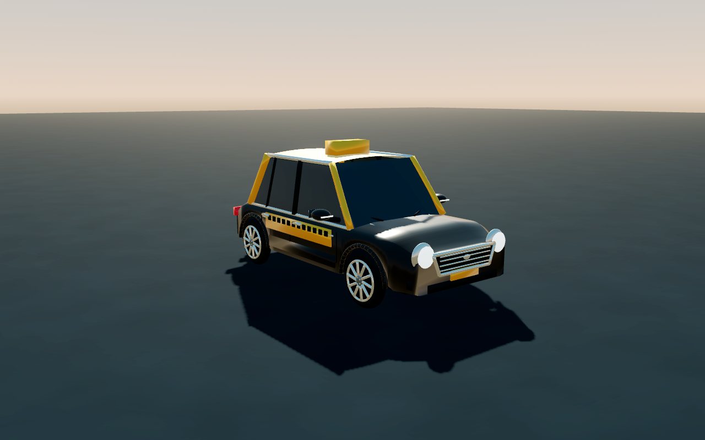 |
| Police | Compact SUV |
| 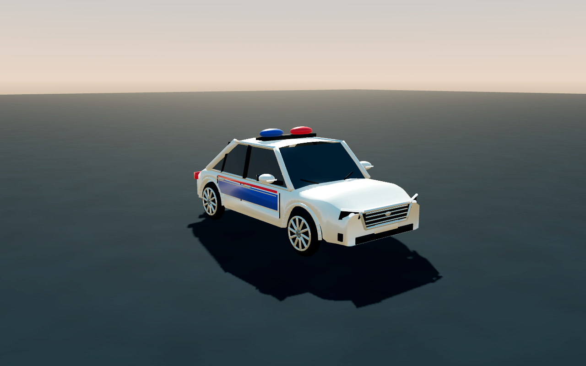 | 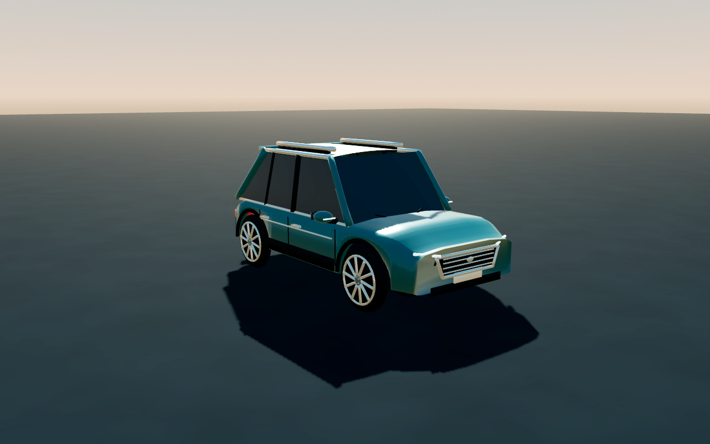 |

Original procedural bodies have curved cross-sections and wheel openings, alloy spokes, grille slats, mirrors, door seams/handles, glazing, roof pillars, running lights and registration text. Taxi: dark body, yellow roof/checker stripe, rounded lamps and roof sign. Police: white body, blue/red side stripes and roof lightbar. SUV: taller cabin, bigger wheels, roof rails and rear spoiler. A medical-response variant replaces the old ambulance box silhouette.

The same models are used by the player, traffic, service/showroom displays and mapped forecourts. Four wheel assemblies roll with movement; only the front axle steers. Body geometry is merged per material; identical style/paint combinations share cached meshes while wheel transforms remain independent. This pass also fixes indexed/non-indexed mesh mixing that would omit custom body panels when combining primitives.

## Reproduce and validate

Run with Godot 4.7.2, or this workspace's `./play.sh` launcher:

```sh
python3 tools/build_compact_city.py
python3 tests/test_compact_data.py
./play.sh --headless --editor --import --quit
./play.sh --headless --script res://tests/compact_world.gd
./play.sh --headless --script res://tests/city_smoke.gd
./play.sh --headless --script res://tests/city_refresh.gd
./play.sh --headless --script res://tests/cafe_review.gd
./play.sh --headless --script res://tests/architecture_review.gd
./play.sh --headless --script res://tests/city_combat.gd
xvfb-run -a ./play.sh --script res://tests/compact_capture.gd
```

Use an isolated `XDG_DATA_HOME` when running gameplay tests directly with the Godot binary: gameplay tests exercise saving. `play.sh` deliberately uses the project's existing local Godot user-data directory.

Final test results and desktop render draw calls are recorded in [validation.json](validation.json). The combat fixture freezes unrelated traffic/crowd routing to test exact contact timing and range without moving street actors affecting the fixture. Historical palace tests were replaced with an assertion that the out-of-area fort is absent; local restaurant entrance, seating, walking and atlas tests remain.

No new APK was installed, and target-tablet performance was not measured. Desktop screenshots run under software OpenGL and are not Android FPS evidence. Existing unrelated Android configuration, build scripts and character-import edits are excluded from this change.
