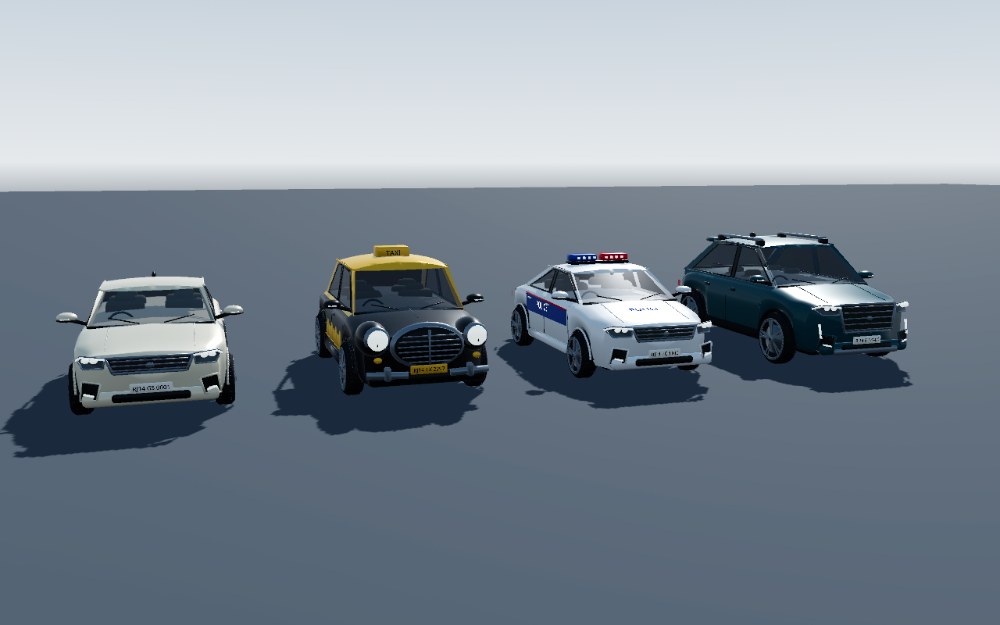
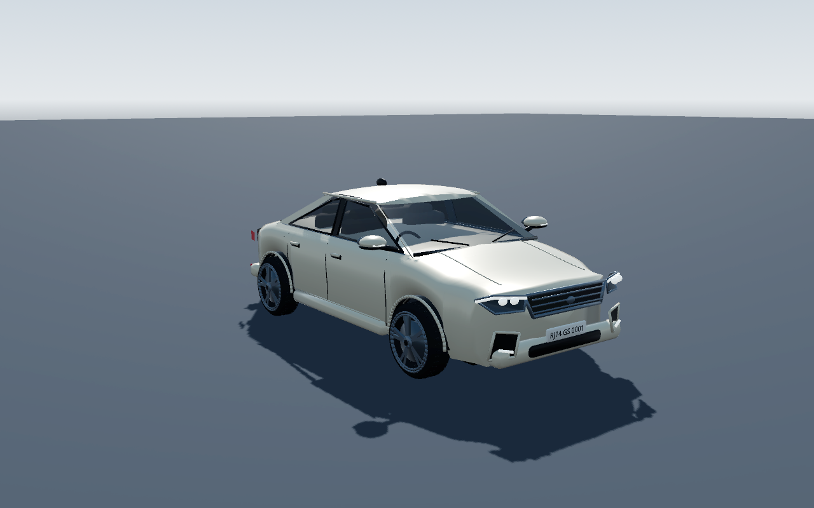
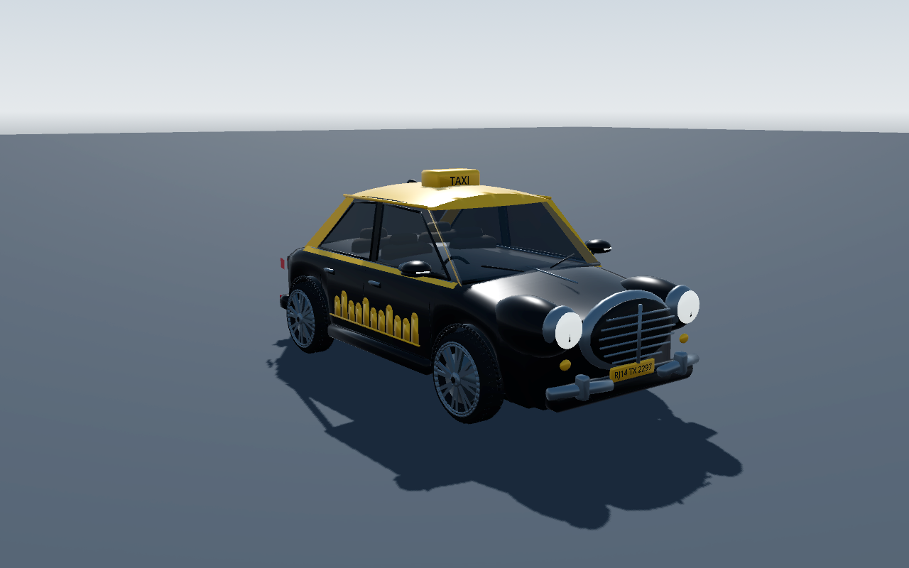
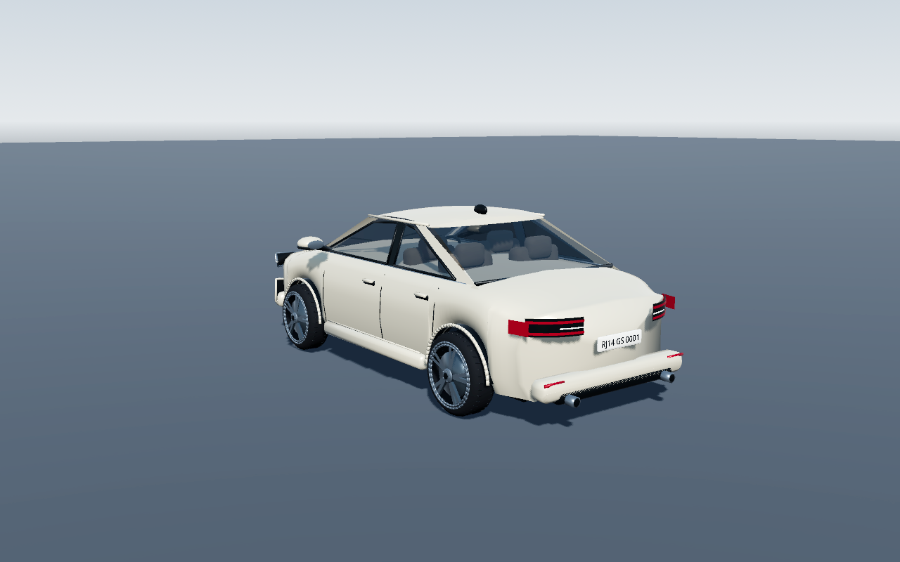
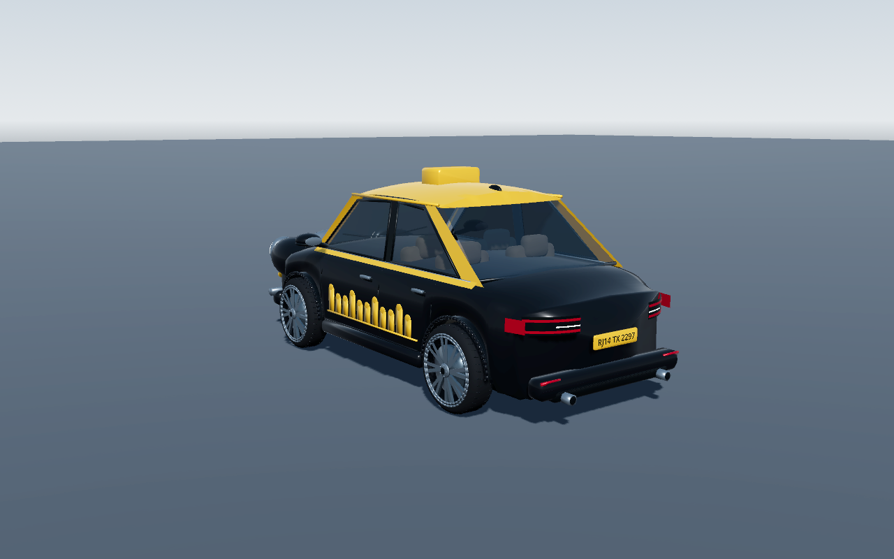
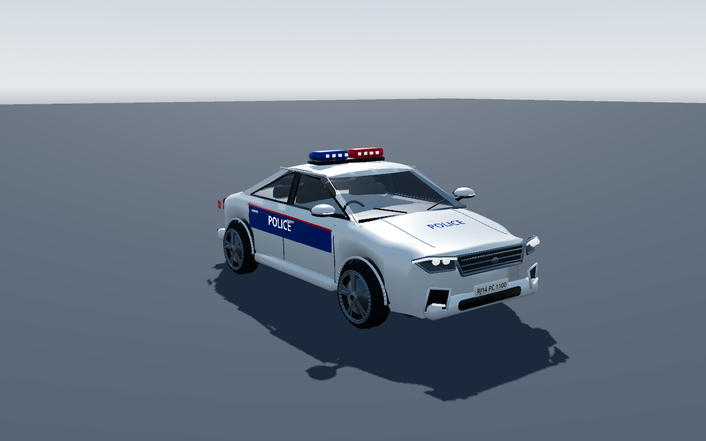
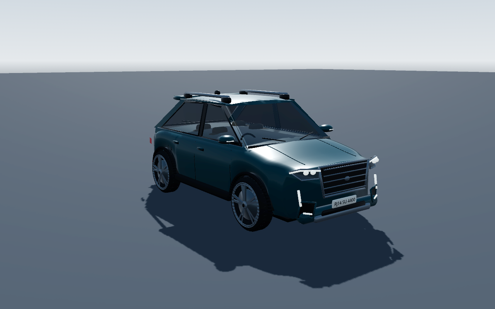
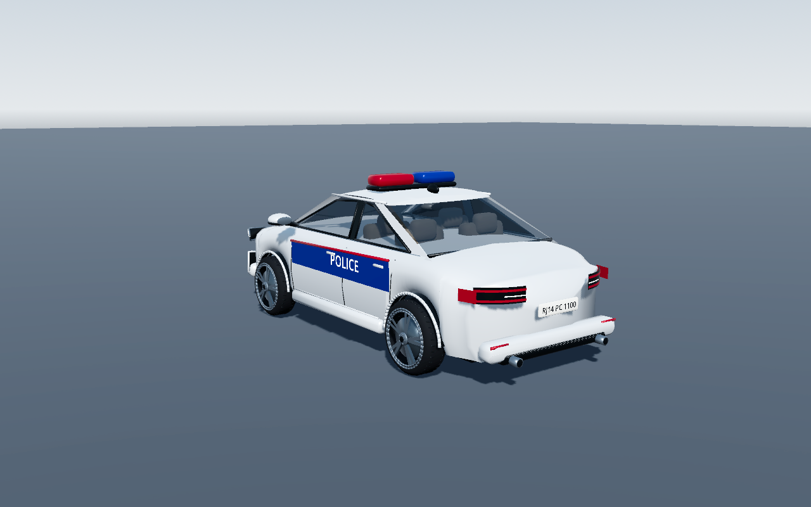
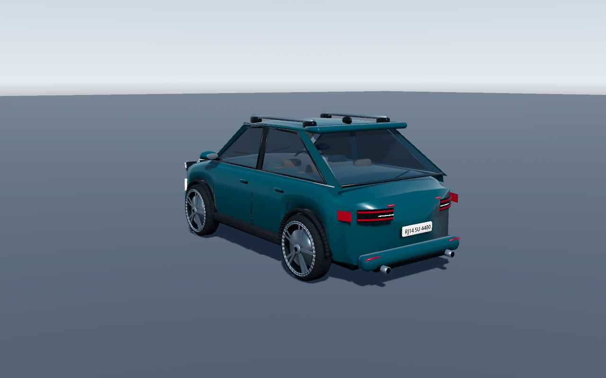
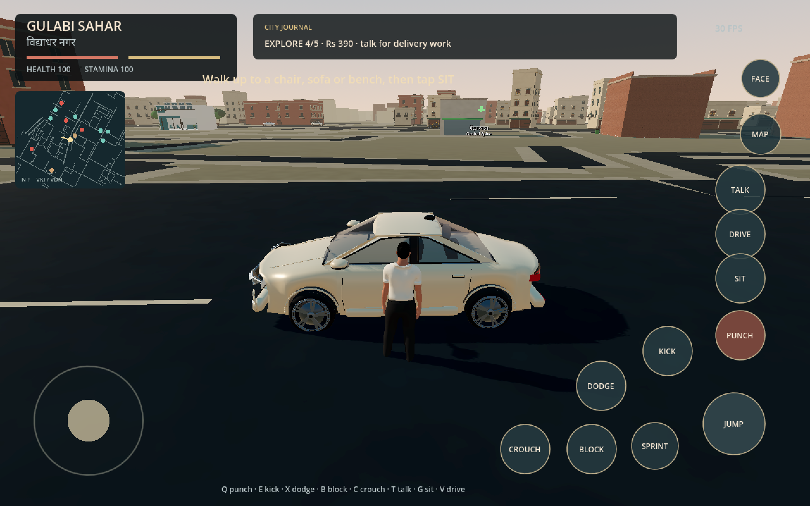

# Vehicle redesign — 13 November 2026

These are actual Godot runtime meshes rendered with the Mobile Vulkan renderer. The user's supplied **Gulabi Sahar: Jaipur Open World** poster is the visual brief. The artwork is a reference; its labels do not change the current VKI/VDN world scope.



## Design brief and implementation

| Family | Reference cues implemented |
|---|---|
| Cream player sedan | Lower swept roof, curved bonnet and shoulders, shaped nose, inset twin-projector lamps, bumper intakes, four doors, cream body and double-spoke alloys |
| Jaipur taxi | Black body, yellow cabin and sign, round lamps, raised front fenders, oval chrome grille, bumper guards, heritage skyline door motif |
| Police patrol | White sedan, blue/red door livery, POLICE door/hood markings, segmented red/blue roof bar |
| Compact SUV | Taller body, raised beltline, large grille, vertical running lights, cladding, larger tyres, roof rails, spoiler and rear wiper |

All four families share the same runtime implementation used by driving, AI traffic, service displays and mapped forecourts. The medical-response variant inherits the SUV geometry. No external vehicle model, marque badge or generated raster substitute is used.

The previous body used nearly vertical panels, opaque slab windows and largely identical profiles. The new body has curved sections and real wheel openings, outward-facing end caps, closed curved roof/windscreen borders and separately framed glass. Interior seats, headrests, dashboard, gear lever and right-hand-drive steering are actual geometry. Headlight lenses, conforming tail lenses, mirrors, door shut lines, handles, number plates, fuel flap and antenna complete the close-range details. Tyres have a full-width sidewall/tread profile; the four wheel assemblies still roll and only the front axle steers.

## Actual views

| Sedan | Taxi |
|---|---|
|  |  |
|  |  |
| Police | SUV |
|  |  |
|  |  |

Side views: [sedan](sedan-side.png), [taxi](taxi-side.png), [police](police-side.png), [SUV](suv-side.png). [Previous sedan](before-sedan.png) was captured in the older desktop Compatibility renderer; lighting differs, so compare geometry rather than colour/brightness.

## Reproduce and verify

```sh
./play.sh --headless --script res://tests/vehicle_geometry.gd
xvfb-run -a ./play.sh --rendering-method mobile --rendering-driver vulkan --script res://tests/vehicle_capture.gd
./build-android.sh standard
python3 tools/install_tablet.py <tablet-ip:port>
```

Run gameplay tests (`tests/compact_world.gd`, `tests/city_refresh.gd`) with an isolated `XDG_DATA_HOME` and the Godot binary directly so they do not modify the desktop player's save. Geometry checks cover finite normals, outward tyre shading, cached mesh reuse, independent wheel animation and steering. Existing compact-world and city-refresh checks cover family silhouettes, save migration, travel, collision and service access.

The visual review caught and corrected lamps buried inside the shell, rear headrests outside the sloping glass, inverted end-cap/tyre/bevel normals, a gap at the windshield roof edge and tail lenses intersecting the rounded rear. Meshes are combined per material and cached by family/paint. Extra geometry and alpha glass have a cost; desktop results are not sustained Android performance measurements.

## One installed app

Version 0.9.7 / code 16. Both export presets use launcher label **Gulabi Sahar** and package `com.itgurujan.gulabisahar.preview`, retaining the installed app's signing key and progress. Standard and preview builds update the same app rather than creating duplicates. The old normal-package copy was removed in the previous installation session.

The supplied poster's photographic paint reflections and exact car shapes are not fully reproduced. These remain authored, stylized game models. Final visual acceptance is the user's decision.

## Final device verification

Wireless update succeeded on tablet 2509BRP2DI. The installed APK SHA-256 matches the final local build exactly; Android reports version 0.9.7 / code 16. There is one Gulabi Sahar package, the launcher label is `Gulabi Sahar`, and saved cash/outfit are retained. Gameplay loaded with no script/parse/fatal errors in the captured process log. The three test suites passed; APK signature, ZIP integrity and 16 KB alignment passed. See [validation record](validation.json).



This capture displays 30 FPS at the spawn area; it is not a sustained performance benchmark.
